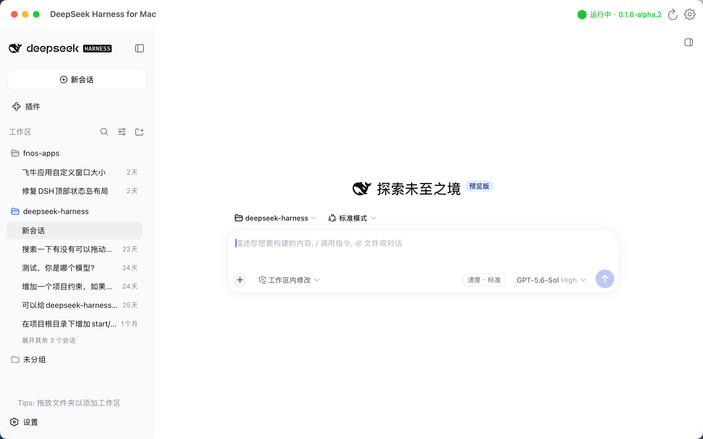
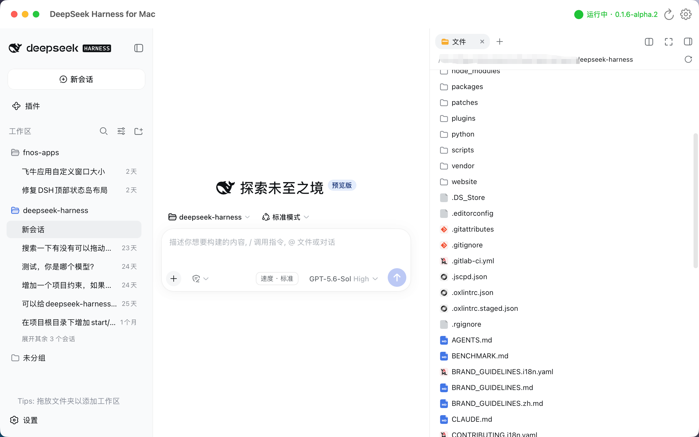
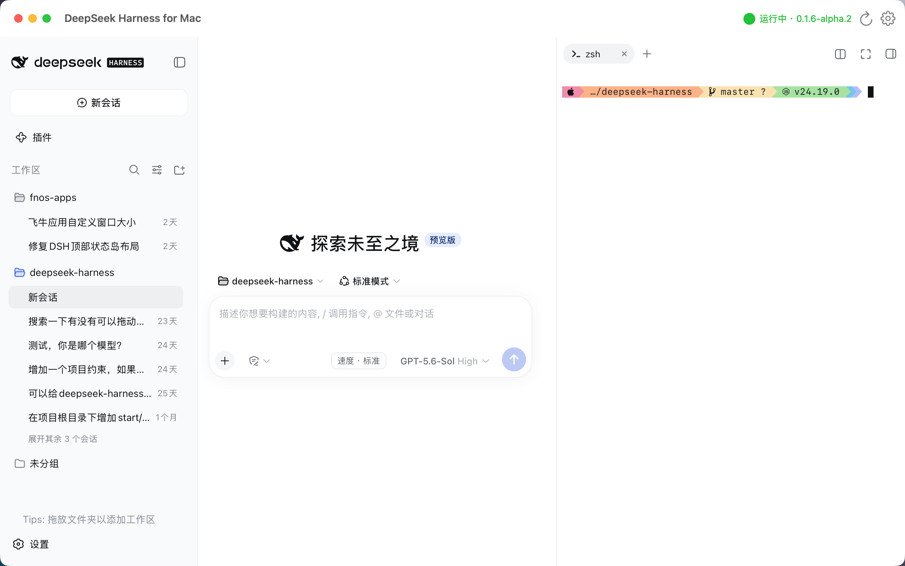
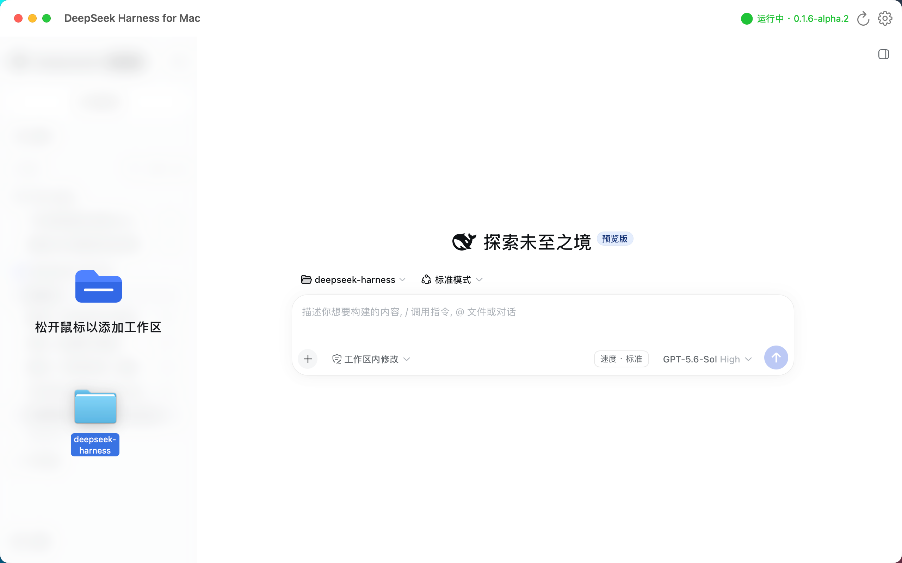
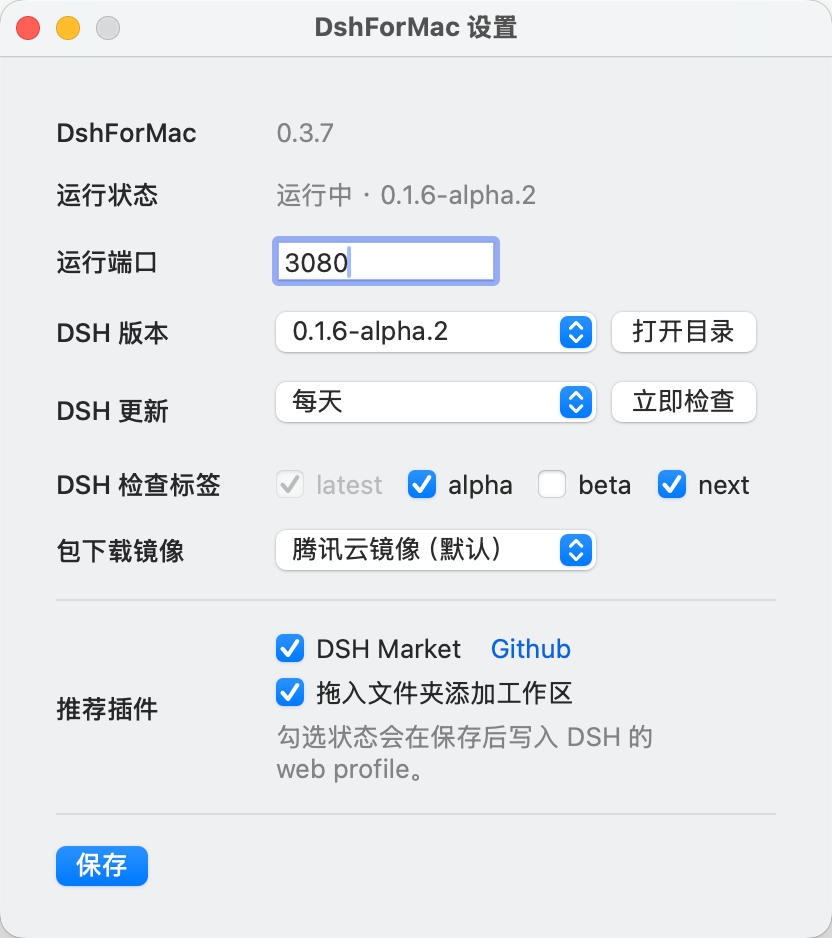
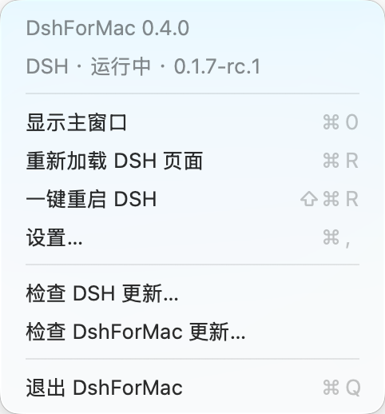

# DshForMac

**DshForMac（DeepSeek Harness for Mac）** 是 [DeepSeek Harness（DSH）](https://github.com/deepseek-ai/deepseek-harness) 的原生 macOS 启动器与本地容器。它负责检测本机 Node.js、下载和管理经过校验的 DSH 版本、启动本地 DSH Web 服务，并在应用窗口中显示 DSH 界面。

它不是 DSH 的分叉实现，不会重定向 DSH 的用户数据，也不会修改全局 npm、pnpm、Node.js 或 shell 配置。

> 项目初衷：网上其实有很多`Mac桌面端`了，但是基本都要求最新的系统或者支持到14/15系统就算好的了，但我觉得应该还是有部分用户仍在使用旧系统（包括我还有台13系统的）。所以，只要你电脑能装dsh必须的`22.19`或`24`以上版本的nodejs，那么你就可以安装这个应用。

## 功能

- 自动检测 Node.js、npm、npx，以及可选的 pnpm/Corepack；支持手动选择 `node` 可执行文件。
- Node.js 可用后自动启动 DSH；首次运行会下载 `@deepseek-ai/dsh` 的精确版本并校验完整性。
- 为每个 DSH 版本建立独立运行时目录；启动健康检查通过后才切换当前版本；按来源标签保留受管版本（`latest` 保留最新 3 个，其他标签各保留最新 2 个），并额外保护当前运行或用户固定的版本。
- 使用内嵌 WebView 打开本机 DSH 服务，默认地址为 `http://127.0.0.1:3080`；端口可在设置中修改。
- 提供 DSH 版本选择、更新检查频率、可多选的 DSH 检查标签（latest 固定勾选）、包下载镜像、端口设置、一键重启与菜单栏控制。
- DshForMac 应用每天检查一次 GitHub 发布版本；发现新版后可稍后提醒、忽略此版本，或直接安装并重启。设置和菜单栏均可手动检查应用更新，失败时可打开 GitHub 发布页面手动安装。
- 设置中可一键启用或禁用推荐插件：已安装的 DSH Market 会自动识别；启用“拖入文件夹添加工作区”后，Finder 文件夹拖到左侧栏会创建 DSH 工作区，右侧仍按 DSH 原逻辑添加对话附件。
- 文件浏览与文本、Markdown、图片、PDF 预览使用 DSH 内置界面；为旧版 macOS 保留必要的 WebKit API 与 PDF Worker 兼容补丁。

## 与官方桌面端的区别

官方桌面端是 Electron 应用，随包携带 Node、pnpm、Python 与固定版 DSH，追求开箱即用；DshForMac 是原生薄壳，复用本机 Node、按需下载 DSH，换取更小的体积、更旧的系统兼容和版本自由。两者都不是 DSH 的分叉，都使用 `~/.dsh`，可以共存。

| 对比项 | DshForMac | 官方桌面端 |
| --- | --- | --- |
| 技术栈 | Swift + AppKit + WKWebView；只额外依赖 Sparkle；不捆绑 Electron/Chromium/Node | Electron 壳（Chromium）；内置 Node、pnpm、Python 3.12 与 DSH 依赖 |
| 体积 | 通用 DMG 约 2.5 MB；安装后约 5.6 MB | macOS 按架构分开：Apple 芯片约 256 MB、Intel 约 276 MB（下载页未列出），Windows 约 280 MB；安装后约 1 GB |
| 系统要求 | macOS 11+；Intel/Apple Silicon 通用；需自备 Node 22.19+/24+ | macOS 13+；Apple 芯片与 Intel 分开打包（Intel 需[直链](https://download.deepseek.com/desktop/dsh-latest-macos-x64.dmg)） |
| DSH 版本 | 不捆绑；可跟 npm 最新版（含 alpha/next）、多版本共存、固定或回滚；与应用更新互相独立 | 与桌面端绑定同一版本，换 DSH 需更新桌面端（当前 Apple 芯片包 0.2.2-rc.1） |
| 运行时与更新 | 首次启动从 registry 下载（默认腾讯镜像，可换源）；应用走 Sparkle/GitHub，不强制；DSH 更新由用户决定 | 运行时随包，无需再下载；更新走官方 CDN，分正式版/开发版通道，可下发强制更新 |
| 系统集成 | 常驻菜单栏（版本、DSH 状态、⌘0/⌘R/⇧⌘R/⇧⌘,）、记住窗口位置、唤醒重连 | macOS 无菜单栏图标；关窗隐藏，用 Dock 或 `dsh://open` 找回；退出前提示运行中的任务 |
| 插件与数据 | 随包两个可选插件：任务提醒（应用内卡片，免通知授权）与 Finder 拖文件夹建工作区；复用 web profile | 无任务完成提醒；插件装在独立的 desktop profile，由内置 pnpm 管理 |
| 可控性与分发 | 端口、镜像、检查频率可配；原生壳无账号与埋点；未签名，Sparkle EdDSA 签名，MIT | 端口由系统分配；Electron 与 DSH 整体验证更新；Developer ID 签名并公证；桌面端含产品埋点 |

### 差异化的意义

- **旧系统与通用包。** 官方最低 macOS 13；本应用从 macOS 11 起，一个包覆盖 Intel 与 Apple Silicon。
- **体积。** 约 5.6 MB 对约 1 GB，旧机器和小硬盘也能长期留着。
- **DSH 版本自由。** 直接跟随 npm，可同时装多个版本、试 alpha/next、固定或回滚；官方只能跟随桌面端发布。
- **原生 macOS 体验。** 菜单栏常驻、免通知授权的任务提醒、Finder 拖文件夹建工作区、唤醒重连；官方 macOS 版没有对应实现。
- **可共存。** 共用 `~/.dsh`，按需切换，不用迁移数据。

### 代价与边界

- 需自备兼容 Node.js；官方不需要。
- 首次启动要联网下载 DSH；官方随包，装完即可用。
- 未签名，首次打开需放行 Gatekeeper；官方已签名公证。
- 不捆绑 Python/Office/语音所需运行时；内嵌 WebKit 与 Chromium 存在行为差异。
- 仅支持 macOS；自由组合版本可能出现官方不会遇到的兼容问题（已有最低版本门槛、健康检查和会话修复兜底）。
- 官方的欢迎引导、自定义快捷键、崩溃诊断、`dsh` CLI 注册等壳层功能，本应用不提供。

### 怎么选

- **官方桌面端：** macOS 13+、想开箱即用，或需要 Python/Office 能力与 Windows 版。
- **DshForMac：** macOS 11/12、已有 Node，或想轻量、追新、锁版本、换镜像。

对比基于 2026-11：本机官方版 0.2.1-rc.4，官方 Apple 芯片包 0.2.2-rc.1；官方迭代较快，以[下载页](https://www.deepseek.com/download/)与[桌面端文档](https://github.com/deepseek-ai/deepseek-harness/blob/master/apps/desktop/README.zh.md)为准。

## 界面预览

点击缩略图可查看原图。

<table>
  <tr>
    <td align="center" width="50%">
      <a href="screenshots/main.png"></a><br>
      <strong>主界面</strong>
    </td>
    <td align="center" width="50%">
      <a href="screenshots/folder-tree.png"></a><br>
      <strong>文件树</strong>
    </td>
  </tr>
  <tr>
    <td align="center">
      <a href="screenshots/terminal.png"></a><br>
      <strong>终端</strong>
    </td>
    <td align="center">
      <a href="screenshots/dragdrop-to-add-workspace.png"></a><br>
      <strong>拖入文件夹添加工作区</strong>
    </td>
  </tr>
  <tr>
    <td align="center">
      <a href="screenshots/setting.png"></a><br>
      <strong>应用设置</strong>
    </td>
    <td align="center">
      <a href="screenshots/tray-menu.png"></a><br>
      <strong>菜单栏</strong>
    </td>
  </tr>
</table>

## 系统要求

- macOS 11 或更高版本。
- DSH `0.1.6` 正式版或更高版本；`0.1.6` 的 alpha、beta、rc 版本不满足此门槛。低版本会提示升级，已安装目录和用户数据保留。
- 可用的 Node.js：v22.19 或更高的 v22，或 v24 及更高版本。
- 与 Node.js 配套的 `npm` 和 `npx`。
- 能访问所选 npm registry。默认使用腾讯云镜像：`https://mirrors.cloud.tencent.com/npm/`。

应用不包含 Node.js。若未检测到兼容版本，DshForMac 会给出说明并可打开 Node.js 官网；安装完成后回到应用重新检测即可。

## 安装与首次启动

1. 打开发布的 `DshForMac-<版本>-unsigned.dmg`。
2. 将 `DshForMac.app` 拖入“应用程序”（`/Applications`）文件夹。
3. 打开 DshForMac。检测到兼容的 Node.js 后，应用会自动下载、校验并启动 DSH；首次启动需要保持网络可用。

当前应用未签名。若 macOS 的 Gatekeeper 阻止打开，请先在“系统设置 → 隐私与安全性”中选择“仍要打开”，或在终端执行下面的命令移除应用的隔离属性：

```sh
sudo xattr -rd com.apple.quarantine /Applications/DshForMac.app
```

执行后再次打开应用。该命令仅应针对你信任来源获得的 DshForMac 应用使用。

## 使用说明

首次成功启动后，DSH 会显示在主窗口中。常用操作如下：

- 菜单栏顶部显示 DshForMac 版本和 DSH 状态；操作区可显示主窗口（⌘0）、重新加载页面（⌘R）、重启 DSH（⇧⌘R）或打开设置（⇧⌘,），下方集中放置 DSH 与应用更新检查。⌘, 留给 DSH 自带的设置快捷键。关闭主窗口后，DSH 服务继续运行。
- 主窗口会记住上次的大小和位置；外接显示器断开后若原位置不可见，下次启动会将窗口移回可见区域。
- Mac 唤醒后会检查本机 DSH 连接；确认断线时自动重试，恢复后重新加载页面。若仍无法恢复，可在页面上点击“重新连接”或使用工具栏重启 DSH。
- 在设置中的 DshForMac 版本号旁，或菜单栏中选择“检查 DshForMac 更新”。应用自动检查每天至多一次，安装前由用户确认；若自动安装失败，可从设置打开 [GitHub 发布页面](https://github.com/hpyer/dsh-for-mac/releases)手动下载。请先将应用从 DMG 拖入“应用程序”，不要直接从 DMG 运行。
- 通过“设置…”修改服务端口、下载镜像、DSH 版本和 DSH 更新检查频率；`latest` 始终检查，可额外选择 alpha 或 next 标签。“运行状态”旁可点击“检查 DSH 更新”，检查结果及“下载”入口显示在同一栏；DSH 版本旁可打开已安装版本目录。每天、每周和每月检查在应用持续运行时也会到期触发；发现 DSH 新版本后工具栏立即提示。本地所选版本过低时，应用会在启动前提示升级，不会因这次检查删除该版本。普通保存后设置窗口保持打开；确认立即重启 DSH 时会关闭设置窗口。
- 在“设置 → 推荐插件”中启用或禁用 DSH Market 与“拖入文件夹添加工作区”；变更会写入 DSH 的 web profile 并自动重启 DSH。
- 在“设置 → 推荐插件”中可启用“后台任务提醒”。随应用提供的本地插件会加入 DSH web profile，当前应用支持的 DSH 版本均满足插件的最低版本要求。应用在后台运行时，任务结束或需要审批、回答问题、审阅计划会显示一张短暂的应用内提醒卡片；看到时点击“打开会话”可返回对应会话。后台任务成功完成时，显示卡片并播放一次 macOS 自带的 Crystal 提示音（系统文件仍名为 `Glass.aiff`）；前台、待处理、取消、失败或原因未知的结束事件不播放完成音。勾选后可点击“发送测试提醒”检查卡片并试听完成音；这只测试应用界面和声音，不验证 DSH 插件事件。提醒只包含通用文案，不含会话正文。卡片会自动跟随系统浅色/深色外观。
- **与 macOS 系统通知的区别：**任务提醒由 DshForMac 自己显示，无需 Apple 开发者签名或系统通知授权；它不会出现在通知中心或锁屏，也不受系统专注模式管理。卡片约 8 秒后消失，错过后没有待处理列表或历史记录。应用退出或 Mac 睡眠时无法提醒；仅在应用仍运行时显示，关闭主窗口不影响提醒。当前未签名发布包无法在 macOS 26.6.2 获取系统通知授权，因此不提供系统通知。
- 当端口已被其他非 DshForMac 管理的服务占用时，请停止该服务或在设置中更换端口。
- 文件与产出物的预览、打开操作由 DSH 内置功能处理。

DSH 的配置、会话和插件仍由 DSH 使用其上游默认用户数据路径管理。DshForMac 只在 `~/Library/Application Support/DshForMac/runtimes/` 下保存受管 DSH 版本。

降级 DSH 后，若历史加载报未知事件错误，可点击错误下方的“修复会话格式…”。修复目标使用当前受管 DSH 版本，不固定某个发布号：须满足应用最低版本要求，并提供 V4 严格会话读取器和可用的会话锁。当前仅处理目标版本不认识的 `job/registered`、`job/settled` 记录，保留消息和事件内容，但旧版不能恢复这些新版后台任务的状态；其他不支持的事件或格式会拒绝修复。同为 V4 不代表事件集合相同，结果仍须通过当前版本的实际读取校验。确认后先备份原始压缩日志并校验，再由目标版本严格校验临时修复结果，最后替换并重启 DSH。备份位于 `~/Library/Application Support/DshForMac/session-backups/`，不自动清理；可通过“文件 → 恢复会话备份…”撤销，恢复前也会备份当前日志。若修复后已有新增历史或备份校验失败，将停止恢复以避免覆盖；原始会话可能需要切回新版 DSH 才能读取。

## 从源码构建

项目使用 Swift Package Manager：

开发需 Xcode 15.2（Swift 5.9）或更新版本；macOS 13 可使用 Xcode 15.2。本地与较新 Xcode 均使用同一套 XCTest 测试，应用的最低运行系统仍为 macOS 11。

```sh
swift test
swift run DshForMac
```

如需生成通用 macOS DMG，请运行：

```sh
./scripts/package-dmg.sh
```

输出文件位于 `dist/`，且为未签名产物。打包脚本不会覆盖同名 DMG；重新构建同一版本前，需要先处理已有产物或更新版本号。源码直接运行时没有可替换的 `.app`，应用更新只在打包后的应用中启用。

## 自动发布

推送形如 `v0.1.0` 的语义化 Git 标签会触发 GitHub Actions。工作流在 Intel 和 Apple Silicon Runner 分别构建与测试，在 macOS Runner 合成一个通用 DMG，并生成带 EdDSA 签名的 `appcast.xml`；两者共同发布到 GitHub Release。应用通过固定的 `releases/latest/download/appcast.xml` 地址检查稳定版，不调用 GitHub Releases API。预发布标签生成的 Release 不会成为默认稳定版更新源。

每次发布时，`CHANGELOG.md` 对应版本条目必须包含独立一行“最低兼容 DSH 版本”，格式为 ``- 最低兼容 DSH 版本：`版本号`。``。版本号须与应用中的 `AppMetadata.minimumSupportedDSHVersion` 一致。发布工作流会校验此行，并把该版本条目原样用作 GitHub Release Notes。

发布前需将与 `Packaging/Info.plist` 中 `SUPublicEDKey` 对应的 Sparkle 私钥，保存为仓库 Actions 密钥 `SPARKLE_PRIVATE_KEY`；缺失时工作流会停止发布。当前公钥对应的私钥保存在本机钥匙串账号 `cn.hpyer.dshformac` 中。已安装并登录 GitHub CLI 时，可执行：

```sh
key_dir="$(mktemp -d)"
.build/artifacts/sparkle/Sparkle/bin/generate_keys --account cn.hpyer.dshformac -x "$key_dir/private-key"
gh secret set SPARKLE_PRIVATE_KEY < "$key_dir/private-key"
rm -f "$key_dir/private-key"
rmdir "$key_dir"
```

也可通过 GitHub 仓库设置添加密钥。不要将私钥提交到仓库；请另行安全备份钥匙串中的密钥。Sparkle 的更新包签名与 Apple Developer ID 签名不同；发布的应用仍未经过 Apple 签名或公证。

发布前请同步更新 `Packaging/Info.plist` 的 `CFBundleShortVersionString`、`AppMetadata.version` 和 `CHANGELOG.md` 中的版本号，并递增 `CFBundleVersion`；工作流会校验前两者必须与标签一致。已安装的旧版本不含应用更新器，需要手动安装一次加入此功能的新版本。新版本的应用包标识为 `cn.hpyer.dshformac`；首次启动时会迁移旧标识下的偏好设置。

更多实现细节见 [架构文档](docs/architecture.md)。

## 本地 DSH 插件

项目自研的 DSH 插件位于 [`dsh-plugins/`](dsh-plugins/)，该目录本身是 pnpm
workspace 根目录。它们与原生壳分开开发和验证，尚未发布为正式 npm 包。

# License

This project is licensed under the [MIT License](LICENSE).
